# Mickey's Racing Adventure and Mickey's Speedway USA: GBC maps

Maps of every course in *Mickey's Racing Adventure* (Game Boy Color, 1999) and *Mickey's Speedway USA* (Game Boy Color, 2001).

  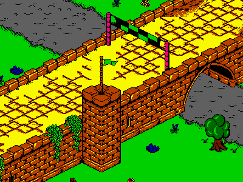
  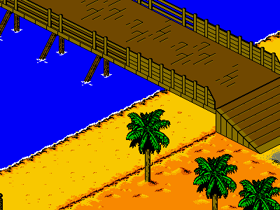
   
  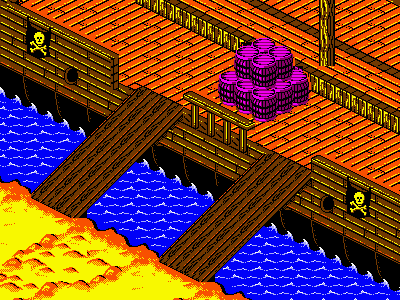
  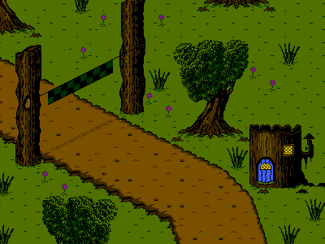

## Mickey's Speedway USA (GBC)

### Courses

<!-- table:msusa-courses -->
<table>
<tr>
<td align="center" valign="top"><a href="images/reconstructed/MSUSA/01_Los_Angeles.png">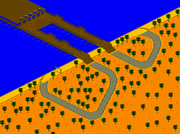</a> Los Angeles <a href="images/reconstructed/MSUSA/01_Los_Angeles.png">PNG</a> · <a href="images/animated/MSUSA/01_Los_Angeles.gif">GIF</a></td>
<td align="center" valign="top"><a href="images/reconstructed/MSUSA/02_Grand_Canyon.png">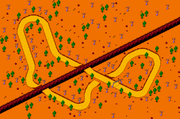</a> Grand Canyon <a href="images/reconstructed/MSUSA/02_Grand_Canyon.png">PNG</a></td>
<td align="center" valign="top"><a href="images/reconstructed/MSUSA/03_Yosemite.png">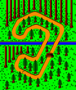</a> Yosemite <a href="images/reconstructed/MSUSA/03_Yosemite.png">PNG</a> · <a href="images/animated/MSUSA/03_Yosemite.gif">GIF</a></td>
<td align="center" valign="top"><a href="images/reconstructed/MSUSA/04_San_Francisco.png">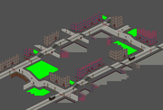</a> San Francisco <a href="images/reconstructed/MSUSA/04_San_Francisco.png">PNG</a></td>
</tr>
<tr>
<td align="center" valign="top"><a href="images/reconstructed/MSUSA/05_Seattle.png">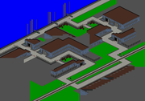</a> Seattle <a href="images/reconstructed/MSUSA/05_Seattle.png">PNG</a> · <a href="images/animated/MSUSA/05_Seattle.gif">GIF</a></td>
<td align="center" valign="top"><a href="images/reconstructed/MSUSA/06_Montana.png">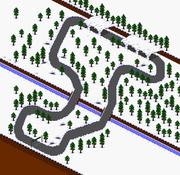</a> Montana <a href="images/reconstructed/MSUSA/06_Montana.png">PNG</a></td>
<td align="center" valign="top"><a href="images/reconstructed/MSUSA/07_Yellowstone.png">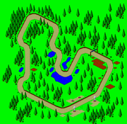</a> Yellowstone <a href="images/reconstructed/MSUSA/07_Yellowstone.png">PNG</a> · <a href="images/animated/MSUSA/07_Yellowstone.gif">GIF</a></td>
<td align="center" valign="top"><a href="images/reconstructed/MSUSA/08_Utah.png">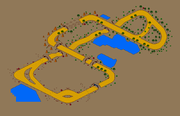</a> Utah <a href="images/reconstructed/MSUSA/08_Utah.png">PNG</a> · <a href="images/animated/MSUSA/08_Utah.gif">GIF</a></td>
</tr>
<tr>
<td align="center" valign="top"><a href="images/reconstructed/MSUSA/09_Milwaukee.png">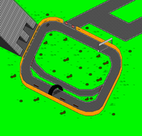</a> Milwaukee <a href="images/reconstructed/MSUSA/09_Milwaukee.png">PNG</a></td>
<td align="center" valign="top"><a href="images/reconstructed/MSUSA/10_Colorado.png">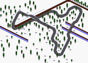</a> Colorado <a href="images/reconstructed/MSUSA/10_Colorado.png">PNG</a></td>
<td align="center" valign="top"><a href="images/reconstructed/MSUSA/11_Nebraska.png">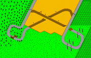</a> Nebraska <a href="images/reconstructed/MSUSA/11_Nebraska.png">PNG</a> · <a href="images/animated/MSUSA/11_Nebraska.gif">GIF</a></td>
<td align="center" valign="top"><a href="images/reconstructed/MSUSA/12_Texas.png">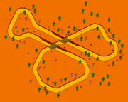</a> Texas <a href="images/reconstructed/MSUSA/12_Texas.png">PNG</a></td>
</tr>
<tr>
<td align="center" valign="top"><a href="images/reconstructed/MSUSA/13_Gulf_Coast.png">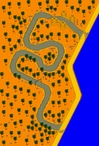</a> Gulf Coast <a href="images/reconstructed/MSUSA/13_Gulf_Coast.png">PNG</a> · <a href="images/animated/MSUSA/13_Gulf_Coast.gif">GIF</a></td>
<td align="center" valign="top"><a href="images/reconstructed/MSUSA/14_Louisiana.png">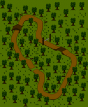</a> Louisiana <a href="images/reconstructed/MSUSA/14_Louisiana.png">PNG</a> · <a href="images/animated/MSUSA/14_Louisiana.gif">GIF</a></td>
<td align="center" valign="top"><a href="images/reconstructed/MSUSA/15_Indianapolis.png">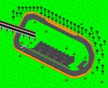</a> Indianapolis <a href="images/reconstructed/MSUSA/15_Indianapolis.png">PNG</a></td>
<td align="center" valign="top"><a href="images/reconstructed/MSUSA/16_Boston.png">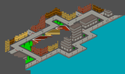</a> Boston <a href="images/reconstructed/MSUSA/16_Boston.png">PNG</a> · <a href="images/animated/MSUSA/16_Boston.gif">GIF</a></td>
</tr>
<tr>
<td align="center" valign="top"><a href="images/reconstructed/MSUSA/17_Smoky_Mountains.png">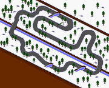</a> Smoky Mountains <a href="images/reconstructed/MSUSA/17_Smoky_Mountains.png">PNG</a></td>
<td align="center" valign="top"><a href="images/reconstructed/MSUSA/18_Florida_Everglades.png">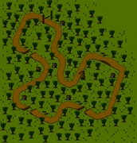</a> Florida Everglades <a href="images/reconstructed/MSUSA/18_Florida_Everglades.png">PNG</a> · <a href="images/animated/MSUSA/18_Florida_Everglades.gif">GIF</a></td>
<td align="center" valign="top"><a href="images/reconstructed/MSUSA/19_Daytona_Beach.png">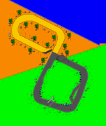</a> Daytona Beach <a href="images/reconstructed/MSUSA/19_Daytona_Beach.png">PNG</a> · <a href="images/animated/MSUSA/19_Daytona_Beach.gif">GIF</a></td>
<td align="center" valign="top"><a href="images/reconstructed/MSUSA/20_Washington_D.C..png">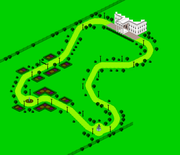</a> Washington D.C. <a href="images/reconstructed/MSUSA/20_Washington_D.C..png">PNG</a> · <a href="images/animated/MSUSA/20_Washington_D.C..gif">GIF</a></td>
</tr>
<tr>
<td align="center" valign="top"> Secret Track! <a href="images/reconstructed/MSUSA/21_Secret_Track%21.png">PNG</a> · <a href="images/animated/MSUSA/21_Secret_Track%21.gif">GIF</a></td>
</tr>
</table>
<!-- /table -->

### Arenas

Previously unseen course data. Apparently for a multiplayer mode. Slot 23's graphics are scrambled (see reconstruction for a general idea of what it may have looked like; there's not really any way to know for sure, but this tileset matches best).

<!-- table:msusa-arenas -->
<table>
<tr>
<td align="center" valign="top"><a href="images/reconstructed/MSUSA_extras/21_Walled_Garden.png">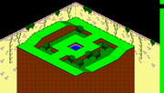</a> 21: Walled garden <a href="images/reconstructed/MSUSA_extras/21_Walled_Garden.png">PNG</a></td>
<td align="center" valign="top"><a href="images/reconstructed/MSUSA_extras/22_Log_Arena.png">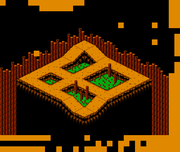</a> 22: Log arena <a href="images/reconstructed/MSUSA_extras/22_Log_Arena.png">PNG</a></td>
<td align="center" valign="top"><a href="images/reconstructed/MSUSA_extras/23_Unfinished_Arena.png">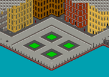</a> 23: Unfinished arena (conjectural) <a href="images/reconstructed/MSUSA_extras/23_Unfinished_Arena.png">Reconstruction</a> · <a href="images/reconstructed/MSUSA_extras/23_Unresolved_Graphics.png">Raw</a></td>
<td align="center" valign="top"><a href="images/reconstructed/MSUSA_extras/24_City_Arena.png">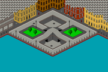</a> 24: City arena <a href="images/reconstructed/MSUSA_extras/24_City_Arena.png">PNG</a></td>
</tr>
</table>
<!-- /table -->

### US map

Course select map with minimum and maximum courses unlocked.

<!-- table:msusa-us-map -->
<table>
<tr>
<td align="center" valign="top"><a href="images/screens/MSUSA_us_map/01_US_Map_Start.png">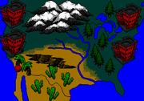</a> US map, start <a href="images/screens/MSUSA_us_map/01_US_Map_Start.png">PNG</a></td>
<td align="center" valign="top"><a href="images/screens/MSUSA_us_map/02_US_Map_Complete.png">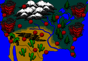</a> US map, complete <a href="images/screens/MSUSA_us_map/02_US_Map_Complete.png">PNG</a></td>
</tr>
</table>
<!-- /table -->

### Course cards

The full-screen title card shown before each course.

<!-- table:msusa-cards -->
<table>
<tr>
<td align="center" valign="top"><a href="images/screens/MSUSA_cards/01_Los_Angeles.png">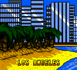</a> Los Angeles <a href="images/screens/MSUSA_cards/01_Los_Angeles.png">PNG</a> · <a href="images/screens/MSUSA_cards/no_caption/01_Los_Angeles.png">No caption</a></td>
<td align="center" valign="top"><a href="images/screens/MSUSA_cards/02_Grand_Canyon.png">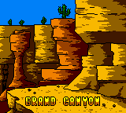</a> Grand Canyon <a href="images/screens/MSUSA_cards/02_Grand_Canyon.png">PNG</a> · <a href="images/screens/MSUSA_cards/no_caption/02_Grand_Canyon.png">No caption</a></td>
<td align="center" valign="top"><a href="images/screens/MSUSA_cards/03_Yosemite.png">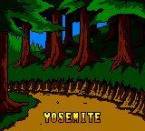</a> Yosemite <a href="images/screens/MSUSA_cards/03_Yosemite.png">PNG</a> · <a href="images/screens/MSUSA_cards/no_caption/03_Yosemite.png">No caption</a></td>
<td align="center" valign="top"><a href="images/screens/MSUSA_cards/04_San_Francisco.png">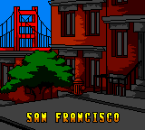</a> San Francisco <a href="images/screens/MSUSA_cards/04_San_Francisco.png">PNG</a> · <a href="images/screens/MSUSA_cards/no_caption/04_San_Francisco.png">No caption</a></td>
</tr>
<tr>
<td align="center" valign="top"><a href="images/screens/MSUSA_cards/05_Seattle.png">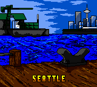</a> Seattle <a href="images/screens/MSUSA_cards/05_Seattle.png">PNG</a> · <a href="images/screens/MSUSA_cards/no_caption/05_Seattle.png">No caption</a></td>
<td align="center" valign="top"><a href="images/screens/MSUSA_cards/06_Montana.png">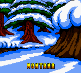</a> Montana <a href="images/screens/MSUSA_cards/06_Montana.png">PNG</a> · <a href="images/screens/MSUSA_cards/no_caption/06_Montana.png">No caption</a></td>
<td align="center" valign="top"><a href="images/screens/MSUSA_cards/07_Yellowstone.png">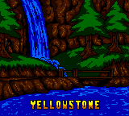</a> Yellowstone <a href="images/screens/MSUSA_cards/07_Yellowstone.png">PNG</a> · <a href="images/screens/MSUSA_cards/no_caption/07_Yellowstone.png">No caption</a></td>
<td align="center" valign="top"><a href="images/screens/MSUSA_cards/08_Utah.png">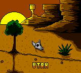</a> Utah <a href="images/screens/MSUSA_cards/08_Utah.png">PNG</a> · <a href="images/screens/MSUSA_cards/no_caption/08_Utah.png">No caption</a></td>
</tr>
<tr>
<td align="center" valign="top"><a href="images/screens/MSUSA_cards/09_Milwaukee.png">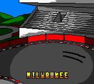</a> Milwaukee <a href="images/screens/MSUSA_cards/09_Milwaukee.png">PNG</a> · <a href="images/screens/MSUSA_cards/no_caption/09_Milwaukee.png">No caption</a></td>
<td align="center" valign="top"><a href="images/screens/MSUSA_cards/10_Colorado.png">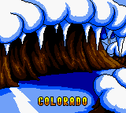</a> Colorado <a href="images/screens/MSUSA_cards/10_Colorado.png">PNG</a> · <a href="images/screens/MSUSA_cards/no_caption/10_Colorado.png">No caption</a></td>
<td align="center" valign="top"><a href="images/screens/MSUSA_cards/11_Nebraska.png">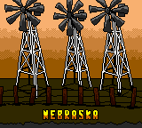</a> Nebraska <a href="images/screens/MSUSA_cards/11_Nebraska.png">PNG</a> · <a href="images/screens/MSUSA_cards/no_caption/11_Nebraska.png">No caption</a></td>
<td align="center" valign="top"><a href="images/screens/MSUSA_cards/12_Texas.png">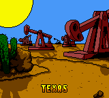</a> Texas <a href="images/screens/MSUSA_cards/12_Texas.png">PNG</a> · <a href="images/screens/MSUSA_cards/no_caption/12_Texas.png">No caption</a></td>
</tr>
<tr>
<td align="center" valign="top"><a href="images/screens/MSUSA_cards/13_Gulf_Coast.png">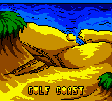</a> Gulf Coast <a href="images/screens/MSUSA_cards/13_Gulf_Coast.png">PNG</a> · <a href="images/screens/MSUSA_cards/no_caption/13_Gulf_Coast.png">No caption</a> · <a href="images/screens/MSUSA_cards/alt_language/21_Golfe_du_Mexique.png">Golfe du Mexique</a> · <a href="images/screens/MSUSA_cards/alt_language/23_Golfkueste.png">Golfküste</a></td>
<td align="center" valign="top"><a href="images/screens/MSUSA_cards/14_Louisiana.png">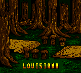</a> Louisiana <a href="images/screens/MSUSA_cards/14_Louisiana.png">PNG</a> · <a href="images/screens/MSUSA_cards/no_caption/14_Louisiana.png">No caption</a> · <a href="images/screens/MSUSA_cards/alt_language/22_Louisiane.png">Louisiane</a></td>
<td align="center" valign="top"><a href="images/screens/MSUSA_cards/15_Indianapolis.png">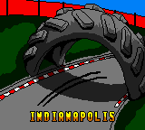</a> Indianapolis <a href="images/screens/MSUSA_cards/15_Indianapolis.png">PNG</a> · <a href="images/screens/MSUSA_cards/no_caption/15_Indianapolis.png">No caption</a></td>
<td align="center" valign="top"><a href="images/screens/MSUSA_cards/16_Boston.png">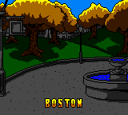</a> Boston <a href="images/screens/MSUSA_cards/16_Boston.png">PNG</a> · <a href="images/screens/MSUSA_cards/no_caption/16_Boston.png">No caption</a></td>
</tr>
<tr>
<td align="center" valign="top"><a href="images/screens/MSUSA_cards/17_Smoky_Mountains.png">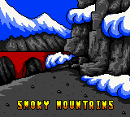</a> Smoky Mountains <a href="images/screens/MSUSA_cards/17_Smoky_Mountains.png">PNG</a> · <a href="images/screens/MSUSA_cards/no_caption/17_Smoky_Mountains.png">No caption</a></td>
<td align="center" valign="top"><a href="images/screens/MSUSA_cards/18_Florida_Everglades.png">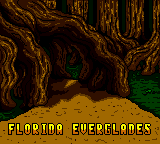</a> Florida Everglades <a href="images/screens/MSUSA_cards/18_Florida_Everglades.png">PNG</a> · <a href="images/screens/MSUSA_cards/no_caption/18_Florida_Everglades.png">No caption</a></td>
<td align="center" valign="top"><a href="images/screens/MSUSA_cards/19_Daytona_Beach.png">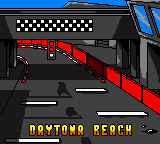</a> Daytona Beach <a href="images/screens/MSUSA_cards/19_Daytona_Beach.png">PNG</a> · <a href="images/screens/MSUSA_cards/no_caption/19_Daytona_Beach.png">No caption</a></td>
<td align="center" valign="top"><a href="images/screens/MSUSA_cards/20_Washington_DC.png">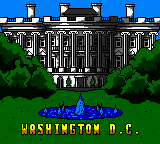</a> Washington D.C. <a href="images/screens/MSUSA_cards/20_Washington_DC.png">PNG</a> · <a href="images/screens/MSUSA_cards/no_caption/20_Washington_DC.png">No caption</a></td>
</tr>
</table>
<!-- /table -->

### Terrain

<!-- table:msusa-terrain -->
<table>
<tr>
<td align="center" valign="top"> Los Angeles <a href="images/terrain/MSUSA/01_Los_Angeles_regions.png">Regions</a> · <a href="images/terrain/MSUSA/01_Los_Angeles_boundaries.png">Boundaries</a></td>
<td align="center" valign="top"> Grand Canyon <a href="images/terrain/MSUSA/02_Grand_Canyon_regions.png">Regions</a> · <a href="images/terrain/MSUSA/02_Grand_Canyon_boundaries.png">Boundaries</a></td>
<td align="center" valign="top"> Yosemite <a href="images/terrain/MSUSA/03_Yosemite_regions.png">Regions</a> · <a href="images/terrain/MSUSA/03_Yosemite_boundaries.png">Boundaries</a></td>
<td align="center" valign="top"> San Francisco <a href="images/terrain/MSUSA/04_San_Francisco_regions.png">Regions</a> · <a href="images/terrain/MSUSA/04_San_Francisco_boundaries.png">Boundaries</a></td>
</tr>
<tr>
<td align="center" valign="top"> Seattle <a href="images/terrain/MSUSA/05_Seattle_regions.png">Regions</a> · <a href="images/terrain/MSUSA/05_Seattle_boundaries.png">Boundaries</a></td>
<td align="center" valign="top"> Montana <a href="images/terrain/MSUSA/06_Montana_regions.png">Regions</a> · <a href="images/terrain/MSUSA/06_Montana_boundaries.png">Boundaries</a></td>
<td align="center" valign="top"> Yellowstone <a href="images/terrain/MSUSA/07_Yellowstone_regions.png">Regions</a> · <a href="images/terrain/MSUSA/07_Yellowstone_boundaries.png">Boundaries</a></td>
<td align="center" valign="top"> Utah <a href="images/terrain/MSUSA/08_Utah_regions.png">Regions</a> · <a href="images/terrain/MSUSA/08_Utah_boundaries.png">Boundaries</a></td>
</tr>
<tr>
<td align="center" valign="top"> Milwaukee <a href="images/terrain/MSUSA/09_Milwaukee_regions.png">Regions</a> · <a href="images/terrain/MSUSA/09_Milwaukee_boundaries.png">Boundaries</a></td>
<td align="center" valign="top"> Colorado <a href="images/terrain/MSUSA/10_Colorado_regions.png">Regions</a> · <a href="images/terrain/MSUSA/10_Colorado_boundaries.png">Boundaries</a></td>
<td align="center" valign="top"> Nebraska <a href="images/terrain/MSUSA/11_Nebraska_regions.png">Regions</a> · <a href="images/terrain/MSUSA/11_Nebraska_boundaries.png">Boundaries</a></td>
<td align="center" valign="top"> Texas <a href="images/terrain/MSUSA/12_Texas_regions.png">Regions</a> · <a href="images/terrain/MSUSA/12_Texas_boundaries.png">Boundaries</a></td>
</tr>
<tr>
<td align="center" valign="top"> Gulf Coast <a href="images/terrain/MSUSA/13_Gulf_Coast_regions.png">Regions</a> · <a href="images/terrain/MSUSA/13_Gulf_Coast_boundaries.png">Boundaries</a></td>
<td align="center" valign="top"> Louisiana <a href="images/terrain/MSUSA/14_Louisiana_regions.png">Regions</a> · <a href="images/terrain/MSUSA/14_Louisiana_boundaries.png">Boundaries</a></td>
<td align="center" valign="top"> Indianapolis <a href="images/terrain/MSUSA/15_Indianapolis_regions.png">Regions</a> · <a href="images/terrain/MSUSA/15_Indianapolis_boundaries.png">Boundaries</a></td>
<td align="center" valign="top"> Boston <a href="images/terrain/MSUSA/16_Boston_regions.png">Regions</a> · <a href="images/terrain/MSUSA/16_Boston_boundaries.png">Boundaries</a></td>
</tr>
<tr>
<td align="center" valign="top"> Smoky Mountains <a href="images/terrain/MSUSA/17_Smoky_Mountains_regions.png">Regions</a> · <a href="images/terrain/MSUSA/17_Smoky_Mountains_boundaries.png">Boundaries</a></td>
<td align="center" valign="top"> Florida Everglades <a href="images/terrain/MSUSA/18_Florida_Everglades_regions.png">Regions</a> · <a href="images/terrain/MSUSA/18_Florida_Everglades_boundaries.png">Boundaries</a></td>
<td align="center" valign="top"> Daytona Beach <a href="images/terrain/MSUSA/19_Daytona_Beach_regions.png">Regions</a> · <a href="images/terrain/MSUSA/19_Daytona_Beach_boundaries.png">Boundaries</a></td>
<td align="center" valign="top"> Washington D.C. <a href="images/terrain/MSUSA/20_Washington_D.C._regions.png">Regions</a> · <a href="images/terrain/MSUSA/20_Washington_D.C._boundaries.png">Boundaries</a></td>
</tr>
<tr>
<td align="center" valign="top"> Secret Track! <a href="images/terrain/MSUSA/21_Secret_Track%21_regions.png">Regions</a> · <a href="images/terrain/MSUSA/21_Secret_Track%21_boundaries.png">Boundaries</a></td>
</tr>
</table>
<!-- /table -->

## Mickey's Racing Adventure

### Courses

<!-- table:mra-courses -->
<table>
<tr>
<td align="center" valign="top"> Round Table Trouble <a href="images/reconstructed/MRA/01_Round_Table_Trouble.png">PNG</a> · <a href="images/animated/MRA/01_Round_Table_Trouble.gif">GIF</a></td>
<td align="center" valign="top"> Drawbridge Derby <a href="images/reconstructed/MRA/02_Drawbridge_Derby.png">PNG</a> · <a href="images/animated/MRA/02_Drawbridge_Derby.gif">GIF</a></td>
<td align="center" valign="top"> Moat Madness <a href="images/reconstructed/MRA/03_Moat_Madness.png">PNG</a> · <a href="images/animated/MRA/03_Moat_Madness.gif">GIF</a></td>
<td align="center" valign="top"> Pete&#x27;s Dungeon <a href="images/reconstructed/MRA/04_Pete%27s_Dungeon.png">PNG</a> · <a href="images/animated/MRA/04_Pete%27s_Dungeon.gif">GIF</a></td>
</tr>
<tr>
<td align="center" valign="top"> Pioneer Prairie <a href="images/reconstructed/MRA/05_Pioneer_Prairie.png">PNG</a> · <a href="images/animated/MRA/05_Pioneer_Prairie.gif">GIF</a></td>
<td align="center" valign="top"> Frozen Frontier <a href="images/reconstructed/MRA/06_Frozen_Frontier.png">PNG</a> · <a href="images/animated/MRA/06_Frozen_Frontier.gif">GIF</a></td>
<td align="center" valign="top"> River Ruckus <a href="images/reconstructed/MRA/07_River_Ruckus.png">PNG</a> · <a href="images/animated/MRA/07_River_Ruckus.gif">GIF</a></td>
<td align="center" valign="top"> Pete&#x27;s Hunting Hideout <a href="images/reconstructed/MRA/08_Pete%27s_Hunting_Hideout.png">PNG</a> · <a href="images/animated/MRA/08_Pete%27s_Hunting_Hideout.gif">GIF</a></td>
</tr>
<tr>
<td align="center" valign="top"> Raceway <a href="images/reconstructed/MRA/09_Raceway.png">PNG</a></td>
<td align="center" valign="top"> Crazy Curves <a href="images/reconstructed/MRA/10_Crazy_Curves.png">PNG</a> · <a href="images/animated/MRA/10_Crazy_Curves.gif">GIF</a></td>
<td align="center" valign="top"> Doughnut Derby <a href="images/reconstructed/MRA/11_Doughnut_Derby.png">PNG</a> · <a href="images/animated/MRA/11_Doughnut_Derby.gif">GIF</a></td>
<td align="center" valign="top"> Pete&#x27;s Dessert Disaster <a href="images/reconstructed/MRA/12_Pete%27s_Dessert_Disaster.png">PNG</a> · <a href="images/animated/MRA/12_Pete%27s_Dessert_Disaster.gif">GIF</a></td>
</tr>
<tr>
<td align="center" valign="top"> Swashbuckling Sand Chase <a href="images/reconstructed/MRA/13_Swashbuckling_Sand_Chase.png">PNG</a> · <a href="images/animated/MRA/13_Swashbuckling_Sand_Chase.gif">GIF</a></td>
<td align="center" valign="top"> Cutthroat Cove <a href="images/reconstructed/MRA/14_Cutthroat_Cove.png">PNG</a> · <a href="images/animated/MRA/14_Cutthroat_Cove.gif">GIF</a></td>
<td align="center" valign="top"> Jolly Roger Ramps <a href="images/reconstructed/MRA/15_Jolly_Roger_Ramps.png">PNG</a> · <a href="images/animated/MRA/15_Jolly_Roger_Ramps.gif">GIF</a></td>
<td align="center" valign="top"> Pete&#x27;s Treasure Oasis <a href="images/reconstructed/MRA/16_Pete%27s_Treasure_Oasis.png">PNG</a> · <a href="images/animated/MRA/16_Pete%27s_Treasure_Oasis.gif">GIF</a></td>
</tr>
<tr>
<td align="center" valign="top"> Roller Coaster Roadway <a href="images/reconstructed/MRA/17_Roller_Coaster_Roadway.png">PNG</a> · <a href="images/animated/MRA/17_Roller_Coaster_Roadway.gif">GIF</a></td>
<td align="center" valign="top"> Really Rapid Rapids <a href="images/reconstructed/MRA/18_Really_Rapid_Rapids.png">PNG</a> · <a href="images/animated/MRA/18_Really_Rapid_Rapids.gif">GIF</a></td>
<td align="center" valign="top"> Fairground Follies <a href="images/reconstructed/MRA/19_Fairground_Follies.png">PNG</a> · <a href="images/animated/MRA/19_Fairground_Follies.gif">GIF</a></td>
<td align="center" valign="top"> Pete&#x27;s Big Top Showdown <a href="images/reconstructed/MRA/20_Pete%27s_Big_Top_Showdown.png">PNG</a> · <a href="images/animated/MRA/20_Pete%27s_Big_Top_Showdown.gif">GIF</a></td>
</tr>
<tr>
<td align="center" valign="top"> Ludwig Von Drake&#x27;s Test Track <a href="images/reconstructed/MRA/21_Ludwig_Von_Drake%27s_Test_Track.png">PNG</a> · <a href="images/animated/MRA/21_Ludwig_Von_Drake%27s_Test_Track.gif">GIF</a></td>
<td align="center" valign="top"> Pete&#x27;s Mansion <a href="images/reconstructed/MRA/22_Pete%27s_Mansion.png">PNG</a></td>
</tr>
</table>
<!-- /table -->

### Overworld

The exploration areas between races, named as players know them (the game shows no title for them).

<!-- table:mra-overworld -->
<table>
<tr>
<td align="center" valign="top"> Ludwig Von Drake&#x27;s Garage <a href="images/reconstructed/MRA_hubs/00_Ludwig_Von_Drake%27s_Garage.png">PNG</a></td>
<td align="center" valign="top"> Mickey&#x27;s Hometown <a href="images/reconstructed/MRA_hubs/01_Mickey%27s_Hometown.png">PNG</a></td>
<td align="center" valign="top"> Casey Junior Junction <a href="images/reconstructed/MRA_hubs/02_Casey_Junior_Junction.png">PNG</a></td>
<td align="center" valign="top"> Magica De Spell&#x27;s House <a href="images/reconstructed/MRA_hubs/03_Magica_De_Spell%27s_House.png">PNG</a></td>
</tr>
<tr>
<td align="center" valign="top"> Chip &#x27;n&#x27; Dale&#x27;s Treehouse Glade <a href="images/reconstructed/MRA_hubs/04_Chip_%27n%27_Dale%27s_Treehouse_Glade.png">PNG</a></td>
<td align="center" valign="top"> Casey Junior Junction Railway <a href="images/reconstructed/MRA_hubs/05_Casey_Junior_Junction_Railway.png">PNG</a></td>
</tr>
</table>
<!-- /table -->

### Adventure maps

The five adventure world maps, reached from the train station, in ROM order.

<!-- table:mra-worlds -->
<table>
<tr>
<td align="center" valign="top"> Mickey&#x27;s Medieval Adventure <a href="images/screens/MRA_worlds/01_Mickey%27s_Medieval_Adventure.png">PNG</a></td>
<td align="center" valign="top"> Donald&#x27;s Pirate Adventure <a href="images/screens/MRA_worlds/02_Donald%27s_Pirate_Adventure.png">PNG</a></td>
<td align="center" valign="top"> Minnie&#x27;s Frontier Adventure <a href="images/screens/MRA_worlds/03_Minnie%27s_Frontier_Adventure.png">PNG</a></td>
<td align="center" valign="top"> Daisy&#x27;s Wonderland Adventure <a href="images/screens/MRA_worlds/04_Daisy%27s_Wonderland_Adventure.png">PNG</a></td>
</tr>
<tr>
<td align="center" valign="top"> Goofy&#x27;s Fairground Adventure <a href="images/screens/MRA_worlds/05_Goofy%27s_Fairground_Adventure.png">PNG</a></td>
</tr>
</table>
<!-- /table -->

### Pluto stages

<!-- table:mra-dig -->
<table>
<tr>
<td align="center" valign="top"> Let&#x27;s Get Started <a href="images/screens/MRA_dig/01_Let%27s_Get_Started.png">PNG</a></td>
<td align="center" valign="top"> Squares <a href="images/screens/MRA_dig/02_Squares.png">PNG</a></td>
<td align="center" valign="top"> Meet Butch <a href="images/screens/MRA_dig/03_Meet_Butch.png">PNG</a></td>
<td align="center" valign="top"> Bash the Bully <a href="images/screens/MRA_dig/04_Bash_the_Bully.png">PNG</a></td>
</tr>
<tr>
<td align="center" valign="top"> Jawbreaker Roll <a href="images/screens/MRA_dig/05_Jawbreaker_Roll.png">PNG</a></td>
<td align="center" valign="top"> Butch Chase <a href="images/screens/MRA_dig/06_Butch_Chase.png">PNG</a></td>
<td align="center" valign="top"> Candy Columns <a href="images/screens/MRA_dig/07_Candy_Columns.png">PNG</a></td>
<td align="center" valign="top"> One Chance Candy Smash <a href="images/screens/MRA_dig/08_One_Chance_Candy_Smash.png">PNG</a></td>
</tr>
<tr>
<td align="center" valign="top"> Pieces of Nineteen <a href="images/screens/MRA_dig/09_Pieces_of_Nineteen.png">PNG</a></td>
<td align="center" valign="top"> Barrels Away <a href="images/screens/MRA_dig/10_Barrels_Away.png">PNG</a></td>
<td align="center" valign="top"> Butch&#x27;s Slimy Demise <a href="images/screens/MRA_dig/11_Butch%27s_Slimy_Demise.png">PNG</a></td>
<td align="center" valign="top"> Double Barrel Drop <a href="images/screens/MRA_dig/12_Double_Barrel_Drop.png">PNG</a></td>
</tr>
<tr>
<td align="center" valign="top"> Pluto&#x27;s Panic <a href="images/screens/MRA_dig/13_Pluto%27s_Panic.png">PNG</a></td>
<td align="center" valign="top"> From the Top <a href="images/screens/MRA_dig/14_From_the_Top.png">PNG</a></td>
<td align="center" valign="top"> Keep Diggin&#x27; <a href="images/screens/MRA_dig/15_Keep_Diggin%27.png">PNG</a></td>
<td align="center" valign="top"> Boulder Drop <a href="images/screens/MRA_dig/16_Boulder_Drop.png">PNG</a></td>
</tr>
<tr>
<td align="center" valign="top"> Back and Forth <a href="images/screens/MRA_dig/17_Back_and_Forth.png">PNG</a></td>
<td align="center" valign="top"> Rock and Roll <a href="images/screens/MRA_dig/18_Rock_and_Roll.png">PNG</a></td>
<td align="center" valign="top"> Quick Dig <a href="images/screens/MRA_dig/19_Quick_Dig.png">PNG</a></td>
<td align="center" valign="top"> Harrowing Rock Hollow <a href="images/screens/MRA_dig/20_Harrowing_Rock_Hollow.png">PNG</a></td>
</tr>
<tr>
<td align="center" valign="top"> Root of the Problem <a href="images/screens/MRA_dig/21_Root_of_the_Problem.png">PNG</a></td>
<td align="center" valign="top"> Circle of Growth <a href="images/screens/MRA_dig/22_Circle_of_Growth.png">PNG</a></td>
<td align="center" valign="top"> Log Jam <a href="images/screens/MRA_dig/23_Log_Jam.png">PNG</a></td>
<td align="center" valign="top"> Quick Slime <a href="images/screens/MRA_dig/24_Quick_Slime.png">PNG</a></td>
</tr>
<tr>
<td align="center" valign="top"> Ducks in a Row <a href="images/screens/MRA_dig/25_Ducks_in_a_Row.png">PNG</a></td>
<td align="center" valign="top"> Domino Ducks <a href="images/screens/MRA_dig/26_Domino_Ducks.png">PNG</a></td>
<td align="center" valign="top"> Duck Drop <a href="images/screens/MRA_dig/27_Duck_Drop.png">PNG</a></td>
<td align="center" valign="top"> Duck! <a href="images/screens/MRA_dig/28_Duck%21.png">PNG</a></td>
</tr>
</table>
<!-- /table -->

### Terrain

<!-- table:mra-terrain -->
<table>
<tr>
<td align="center" valign="top"> Round Table Trouble <a href="images/terrain/MRA/01_Round_Table_Trouble_regions.png">Regions</a> · <a href="images/terrain/MRA/01_Round_Table_Trouble_boundaries.png">Boundaries</a></td>
<td align="center" valign="top"> Drawbridge Derby <a href="images/terrain/MRA/02_Drawbridge_Derby_regions.png">Regions</a> · <a href="images/terrain/MRA/02_Drawbridge_Derby_boundaries.png">Boundaries</a></td>
<td align="center" valign="top"> Moat Madness <a href="images/terrain/MRA/03_Moat_Madness_regions.png">Regions</a> · <a href="images/terrain/MRA/03_Moat_Madness_boundaries.png">Boundaries</a></td>
<td align="center" valign="top"> Pete&#x27;s Dungeon <a href="images/terrain/MRA/04_Pete%27s_Dungeon_regions.png">Regions</a> · <a href="images/terrain/MRA/04_Pete%27s_Dungeon_boundaries.png">Boundaries</a></td>
</tr>
<tr>
<td align="center" valign="top"> Pioneer Prairie <a href="images/terrain/MRA/05_Pioneer_Prairie_regions.png">Regions</a> · <a href="images/terrain/MRA/05_Pioneer_Prairie_boundaries.png">Boundaries</a></td>
<td align="center" valign="top"> Frozen Frontier <a href="images/terrain/MRA/06_Frozen_Frontier_regions.png">Regions</a> · <a href="images/terrain/MRA/06_Frozen_Frontier_boundaries.png">Boundaries</a></td>
<td align="center" valign="top"> River Ruckus <a href="images/terrain/MRA/07_River_Ruckus_regions.png">Regions</a> · <a href="images/terrain/MRA/07_River_Ruckus_boundaries.png">Boundaries</a></td>
<td align="center" valign="top"> Pete&#x27;s Hunting Hideout <a href="images/terrain/MRA/08_Pete%27s_Hunting_Hideout_regions.png">Regions</a> · <a href="images/terrain/MRA/08_Pete%27s_Hunting_Hideout_boundaries.png">Boundaries</a></td>
</tr>
<tr>
<td align="center" valign="top"> Raceway <a href="images/terrain/MRA/09_Raceway_regions.png">Regions</a> · <a href="images/terrain/MRA/09_Raceway_boundaries.png">Boundaries</a></td>
<td align="center" valign="top"> Crazy Curves <a href="images/terrain/MRA/10_Crazy_Curves_regions.png">Regions</a> · <a href="images/terrain/MRA/10_Crazy_Curves_boundaries.png">Boundaries</a></td>
<td align="center" valign="top"> Doughnut Derby <a href="images/terrain/MRA/11_Doughnut_Derby_regions.png">Regions</a> · <a href="images/terrain/MRA/11_Doughnut_Derby_boundaries.png">Boundaries</a></td>
<td align="center" valign="top"> Pete&#x27;s Dessert Disaster <a href="images/terrain/MRA/12_Pete%27s_Dessert_Disaster_regions.png">Regions</a> · <a href="images/terrain/MRA/12_Pete%27s_Dessert_Disaster_boundaries.png">Boundaries</a></td>
</tr>
<tr>
<td align="center" valign="top"> Swashbuckling Sand Chase <a href="images/terrain/MRA/13_Swashbuckling_Sand_Chase_regions.png">Regions</a> · <a href="images/terrain/MRA/13_Swashbuckling_Sand_Chase_boundaries.png">Boundaries</a></td>
<td align="center" valign="top"> Cutthroat Cove <a href="images/terrain/MRA/14_Cutthroat_Cove_regions.png">Regions</a> · <a href="images/terrain/MRA/14_Cutthroat_Cove_boundaries.png">Boundaries</a></td>
<td align="center" valign="top"> Jolly Roger Ramps <a href="images/terrain/MRA/15_Jolly_Roger_Ramps_regions.png">Regions</a> · <a href="images/terrain/MRA/15_Jolly_Roger_Ramps_boundaries.png">Boundaries</a></td>
<td align="center" valign="top"> Pete&#x27;s Treasure Oasis <a href="images/terrain/MRA/16_Pete%27s_Treasure_Oasis_regions.png">Regions</a> · <a href="images/terrain/MRA/16_Pete%27s_Treasure_Oasis_boundaries.png">Boundaries</a></td>
</tr>
<tr>
<td align="center" valign="top"> Roller Coaster Roadway <a href="images/terrain/MRA/17_Roller_Coaster_Roadway_regions.png">Regions</a> · <a href="images/terrain/MRA/17_Roller_Coaster_Roadway_boundaries.png">Boundaries</a></td>
<td align="center" valign="top"> Really Rapid Rapids <a href="images/terrain/MRA/18_Really_Rapid_Rapids_regions.png">Regions</a> · <a href="images/terrain/MRA/18_Really_Rapid_Rapids_boundaries.png">Boundaries</a></td>
<td align="center" valign="top"> Fairground Follies <a href="images/terrain/MRA/19_Fairground_Follies_regions.png">Regions</a> · <a href="images/terrain/MRA/19_Fairground_Follies_boundaries.png">Boundaries</a></td>
<td align="center" valign="top"> Pete&#x27;s Big Top Showdown <a href="images/terrain/MRA/20_Pete%27s_Big_Top_Showdown_regions.png">Regions</a> · <a href="images/terrain/MRA/20_Pete%27s_Big_Top_Showdown_boundaries.png">Boundaries</a></td>
</tr>
<tr>
<td align="center" valign="top"> Ludwig Von Drake&#x27;s Test Track <a href="images/terrain/MRA/21_Ludwig_Von_Drake%27s_Test_Track_regions.png">Regions</a> · <a href="images/terrain/MRA/21_Ludwig_Von_Drake%27s_Test_Track_boundaries.png">Boundaries</a></td>
<td align="center" valign="top"> Pete&#x27;s Mansion <a href="images/terrain/MRA/22_Pete%27s_Mansion_regions.png">Regions</a> · <a href="images/terrain/MRA/22_Pete%27s_Mansion_boundaries.png">Boundaries</a></td>
</tr>
</table>
<!-- /table -->

## Documentation

- [Building the maps](docs/BUILD.md): how to rebuild and verify everything from your own ROMs.
- [Map formats and evidence](docs/FORMAT.md): how each data format is laid out, how it was decoded, and how the decoding was verified.
- [Engine notes](docs/ENGINE.md): ROM routines, RAM layout, and runtime behavior traced so far, plus open questions.
